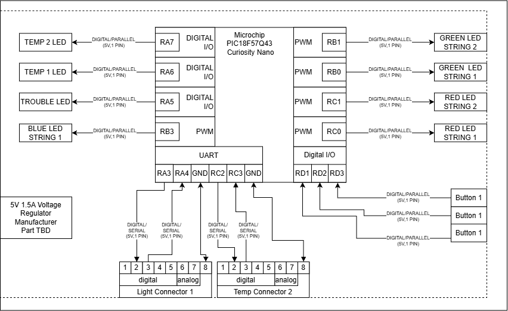

## Overview
The block diagram shows the Microchip PIC-Nano board and its associated inputs and outputs. The general purpose of this design is to receive digital values from its companion boards. The values received will be used in conjunction with user selected settings to perform a set of functions. Those functions include mood lighting and an led light to display information from a temperature sensor. The board runs on 5V DC. The LED array uses a 9v DC bus and is switched on using MOSFETs controlled by PWM modules from the PIC Nano. The device has 3 push buttons that provide digital inputs to the board, which in turn provide the user with an interface to operate the device.

## Block Diagram 

## Resouces

The block diagram as a PDF download is available [*here*](PersonalBlockDiagramCLP.pdf), and a source file [*here*](https://app.diagrams.net/#G1LWr9XpyrrQmtF6XwokvjWBBkdfSSz1ql#%7B%22pageId%22%3A%22JaI7Hm2gRzim2e01LkNA%22%7D).