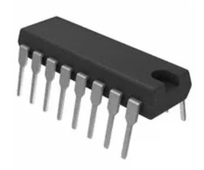
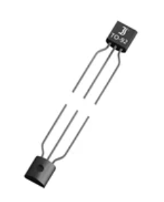
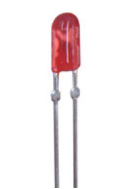
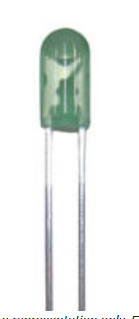
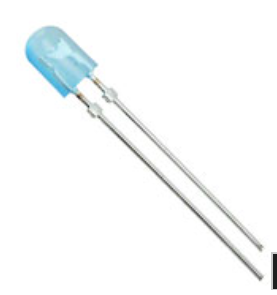
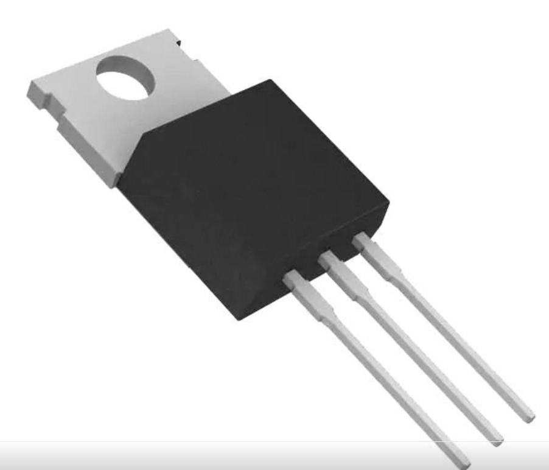

## Module's Selected Major Components

# Components

## Control LED Array

| Solution | Description | Pros | Cons |
|---|---|---|---|
| [SN74HC595](https://www.digikey.com/en/products/detail/texas-instruments/SN74HC595N/277246) |  Option 1: SNx4HC595 — $1.83 each | Can turn on each LED individually. Can control a larger array of LEDs. | Limited LED power available. Must be used with other components to meet design needs. |
| [MOSFET 2N7000](https://www.digikey.com/en/products/detail/dcomponents/2N7000/13575174) |  Option 2: 2N7000 MOSFETs — $1.09 each | Fewer components means less error prone. Very reliable product. Easy to design and implement. | Less control over individual LEDs. |
| **Selection** | **MOSFET 2N7000** | **Rationale** | Individual MOSFETs will allow the control of a string of LEDs and are rated for the current and voltages needed. The PIC has enough control outputs that the register is unnecessary and overly complicated. |

## LED Array

| Solution | Description | Pros | Cons |
|---|---|---|---|
| [C5SMF-RJF-CT0W0BB2](https://www.digikey.com/en/products/detail/cree-led/C5SMF-RJF-CT0W0BB2/4794052) |  Option 1: C5SMF-RJF-CT0W0BB2 — $0.21 each | Correct form and specs for application. Red can simulate the sunrise/sunset desired for the design. Fairly reliable product that is readily available. | Single LED color selection will not provide enough for the ambient lighting design. Low lumen output. |
| [C5SMF-GJE-CX14Q7T2](https://www.digikey.com/en/products/detail/cree-led/C5SMF-GJE-CX14Q7T2/4794039) |  Option 2: C5SMF-GJE-CX14Q7T2 — $0.36 each | Correct form and specs for application. Can help create a calming earth-tone mood lighting as designed. | Single LED color selection will not provide enough for the ambient lighting design. Voltage needed is slightly higher than other options. |
| [C5SMF-BJF-CR0U0351](https://www.digikey.com/en/products/detail/cree-led/C5SMF-BJF-CR0U0351/4793781) |  Option 3: C5SMF-BJF-CR0U0351 — $0.23 each | Correct form and specs for application. Blue light can create an underwater or blue-sky effect when indoors. | Single LED color selection will not provide enough for the ambient lighting design. Lumen output is low. |
| **Selection** | **All three LEDs will be used** | **Rationale** | Each LED will provide a different color. This will allow for more customization of the resulting color output instead of having only a single color. |

### Power Management

**2156-LM7805CT-ND**:Linear Voltage Regulator IC Positive Fixed 1 Output 1.5A TO-220-3 used to create 5v DC from the 9v DC 3A power supply. 

Link to Digikey ["Link to part"](https://www.digikey.com/en/products/detail/rochester-electronics-llc/LM7805CT/12600247) 

