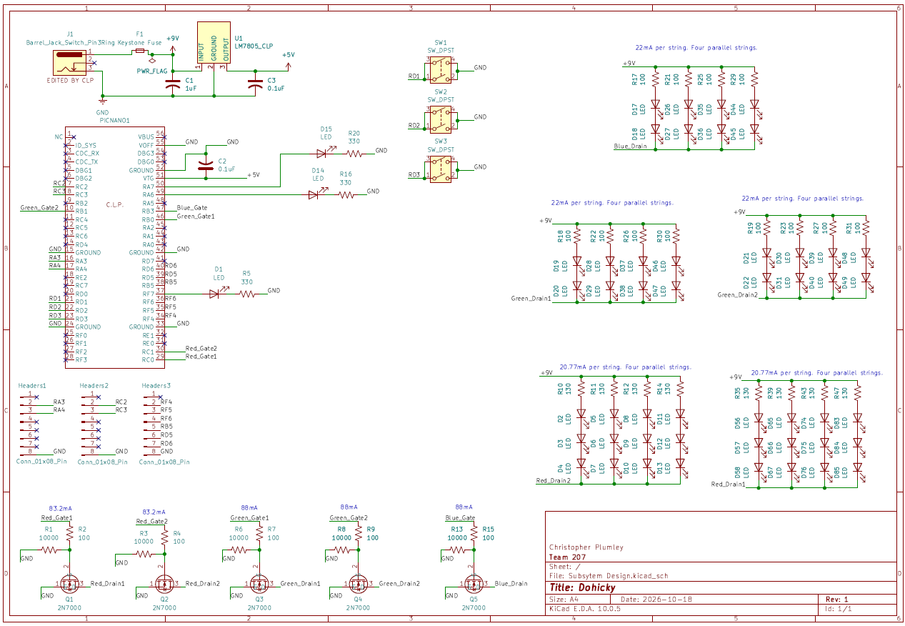

## Overview

The schematic shown below is for the Dohicky device. It uses two inputs from the partner boards. The first is a digital signal representation of the ambient temperature around the device. This signal is used to output a set of LEDs. The other signal is the light intensity around the device. This input allows the device to turn on an array of LEDs for ambient lighting. Thus the sensor, processing, and communication to the partner boards requirements for this project are satisfied. This board modulates its outputs to MOSFET devices with LED strings illuminating in various fequencies and light intensity. Push buttons offer preselected patterns and color options. These outputs satisfy the remaining requirements for the project. Though it should be noted that the output was not a motor driver or actuator, the level of complexity was enough to earn a special expemtion from the professor. 

**Figure 1** Showing my schematic.

## Resouces

The schematic as a PDF download is available [*here*](Schematic.pdf), and the Zip folder of the project [*here*](Subsystem.zip).