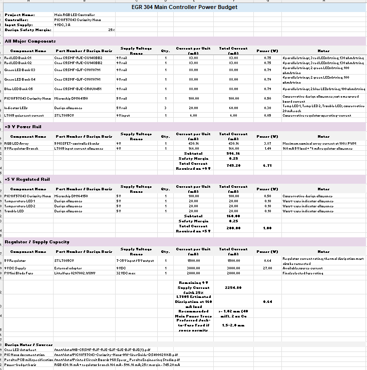

## Overview
Below is the power budget for my individual board. The majority of the power is used by the 5 LED channels powered by the 9v DC bus and controlled by the PIC NANO 5v DC switch to the MOSFETs. A safety margin of 25% was used and a 2A fuse was selected to protect the board from any surges that may come from the 9vDC 3A power supply. 

# Power Budget

## Overview

The system is powered by a **9 VDC, 3 A power supply**. The +9 V rail directly supplies the RGB LED arrays and also supplies an L7805 linear voltage regulator. The L7805 provides the +5 V rail used by the PIC18F57Q43 Curiosity Nano and indicator LEDs.

A **25% safety margin** is applied to the calculated maximum current requirement.

## Major Components

| Component | Supply Voltage | Qty. | Current per Device | Total Current |
|---|---:|---:|---:|---:|
| Red LED Bank 1 | +9 V | 1 | 83.08 mA | 83.08 mA |
| Red LED Bank 2 | +9 V | 1 | 83.08 mA | 83.08 mA |
| Green LED Bank 1 | +9 V | 1 | 88.00 mA | 88.00 mA |
| Green LED Bank 2 | +9 V | 1 | 88.00 mA | 88.00 mA |
| Blue LED Bank | +9 V | 1 | 88.00 mA | 88.00 mA |
| PIC18F57Q43 Curiosity Nano | +5 V | 1 | 100 mA* | 100 mA |
| Temperature LED 1 | +5 V | 1 | 20 mA* | 20 mA |
| Temperature LED 2 | +5 V | 1 | 20 mA* | 20 mA |
| Trouble LED | +5 V | 1 | 20 mA* | 20 mA |
| L7805 operating-current allowance | +9 V | 1 | 6 mA* | 6 mA |

\* Values marked with an asterisk are conservative design allowances used for power-budget calculations.

---

## +9 V RGB LED Rail

The RGB array contains five independently controlled LED banks. Each bank is switched using a 2N7000 MOSFET.

| Load | Supply | Current |
|---|---:|---:|
| Red Bank 1 | +9 V | 83.08 mA |
| Red Bank 2 | +9 V | 83.08 mA |
| Green Bank 1 | +9 V | 88.00 mA |
| Green Bank 2 | +9 V | 88.00 mA |
| Blue Bank | +9 V | 88.00 mA |
| **RGB Array Subtotal** | | **430.16 mA** |

The maximum RGB-array current is therefore:

\[
I_{RGB}=83.08+83.08+88+88+88
\]

\[
\boxed{I_{RGB}=430.16\text{ mA}}
\]

The approximate maximum power supplied to the RGB array is:

\[
P_{RGB}=VI
\]

\[
P_{RGB}=9(0.43016)
\]

\[
\boxed{P_{RGB}\approx3.87\text{ W}}
\]

---

## +5 V Power Rail

The +5 V rail is generated by the L7805 linear voltage regulator.

| Load | Supply | Current |
|---|---:|---:|
| PIC18F57Q43 Curiosity Nano | +5 V | 100 mA |
| Temperature LED 1 | +5 V | 20 mA |
| Temperature LED 2 | +5 V | 20 mA |
| Trouble LED | +5 V | 20 mA |
| **+5 V Rail Subtotal** | | **160 mA** |

Therefore:

\[
I_{5V}=100+20+20+20
\]

\[
\boxed{I_{5V}=160\text{ mA}}
\]

---

## L7805 Regulator

The L7805 converts the +9 V input rail to +5 V.

The voltage dropped across the regulator is:

\[
V_{drop}=9-5
\]

\[
\boxed{V_{drop}=4\text{ V}}
\]

At a maximum +5 V load of approximately 160 mA, the regulator dissipates:

\[
P_{L7805}=V_{drop}I
\]

\[
P_{L7805}=4(0.160)
\]

\[
\boxed{P_{L7805}\approx0.64\text{ W}}
\]

Approximately 6 mA is additionally reserved as a conservative regulator operating-current allowance.

---

## Total +9 V Input Current

The +9 V supply must provide current for both the RGB array and the +5 V regulator branch.

| Load | Current |
|---|---:|
| RGB LED Array | 430.16 mA |
| +5 V Loads through L7805 | 160.00 mA |
| L7805 Operating Allowance | 6.00 mA |
| **Subtotal** | **596.16 mA** |

Therefore:

\[
I_{TOTAL}=430.16+160+6
\]

\[
\boxed{I_{TOTAL}=596.16\text{ mA}}
\]

---

## Safety Margin

A **25% safety margin** is applied to the calculated maximum current:

\[
I_{DESIGN}=I_{TOTAL}(1.25)
\]

\[
I_{DESIGN}=596.16(1.25)
\]

\[
\boxed{I_{DESIGN}=745.2\text{ mA}}
\]

The design therefore uses approximately **0.75 A** as the maximum design current.

---

## Power Supply Capacity

The selected power supply is rated:

\[
9\text{ VDC},\ 3\text{ A}
\]

Maximum supply capacity:

\[
P_{SUPPLY}=9(3)
\]

\[
\boxed{P_{SUPPLY}=27\text{ W}}
\]

The design requires approximately:

\[
P_{DESIGN}=9(0.7452)
\]

\[
\boxed{P_{DESIGN}\approx6.71\text{ W}}
\]

The remaining supply-current capacity is:

\[
I_{remaining}=3.0-0.7452
\]

\[
\boxed{I_{remaining}\approx2.25\text{ A}}
\]

Therefore, the **9 VDC / 3 A supply provides sufficient capacity for the system**.

---

## Fuse Selection

The calculated maximum operating current is approximately:

\[
596\text{ mA}
\]

and the design current including the 25% safety margin is approximately:

\[
745\text{ mA}
\]

A **2 A Mini/ATM automotive blade fuse** is selected for F1.

| Component | Manufacturer | Part Number | Rating |
|---|---|---|---:|
| F1 Mini Blade Fuse | Littelfuse | 0297002.WXNV | 2 A |
| F1 PCB Fuse Holder | Littelfuse | 01530007Z | 15 A holder |

The 2 A fuse provides sufficient margin above the normal operating current while protecting the PCB against significant overcurrent faults from the 3 A power supply.

---

## PCB Power Trace Requirements

The PCB uses **2 oz copper**.

The calculated design current on the main +9 V input is approximately:

\[
\boxed{0.75\text{ A}}
\]

The minimum configured power and ground trace width is:

\[
40\text{ mil}=1.02\text{ mm}
\]

A **1.02 mm minimum width** is sufficient for the calculated board current. Where PCB space permits, the primary path from the barrel jack through F1 to the main power-distribution point should be increased to approximately:

\[
\boxed{1.5-2.0\text{ mm}}
\]

The individual MOSFET-controlled LED banks carry only approximately **83–88 mA each**, substantially less than the main +9 V input current.

---

## Power Budget Summary

| Parameter | Calculated Value |
|---|---:|
| RGB Array Maximum Current | 430.16 mA |
| +5 V Load | 160 mA |
| L7805 Operating Allowance | 6 mA |
| Maximum Calculated Input Current | 596.16 mA |
| Safety Margin | 25% |
| Design Current | **745.2 mA** |
| Approximate Design Power | **6.71 W** |
| Power Supply | **9 VDC / 3 A / 27 W** |
| Remaining Supply Capacity | **2.25 A** |
| Selected Fuse | **2 A Mini/ATM** |
| Minimum Power/Ground Trace | **1.02 mm (40 mil)** |
| Recommended Main Input Trace | **1.5–2.0 mm** |

The selected **9 VDC / 3 A power supply provides substantial current margin above the calculated system requirement**, while the 2 A fuse provides overcurrent protection for the PCB.
{style width:"250" height:"200;"}

## Conclusions

This design has a power budget that is well below design limits. The fuse selected to protect the device is slightly oversized. There were supply constraints and a 1A fuse was not available. Given ideal conditions a load of 0.75 A would be better protected with a 1A fuse. The power budget shows that the design is well below the available power for the supply and is within tolorance of the devices used in the system. 

## Resouces

The power budget as a PDF download is available [*here*](Power_Budget.pdf), and a Microsoft Excel Sheet [*here*](Individual_Power_Budget.xlsx).